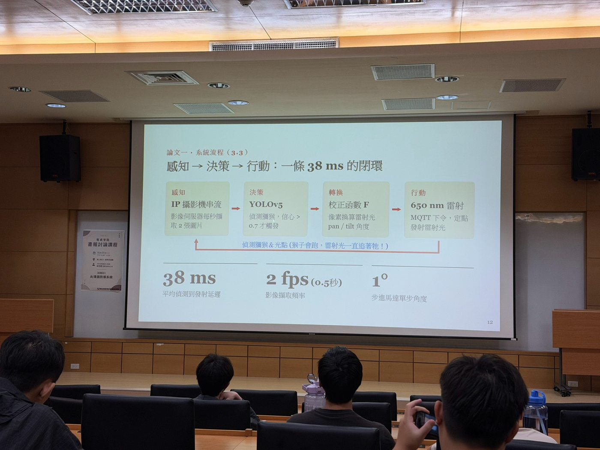
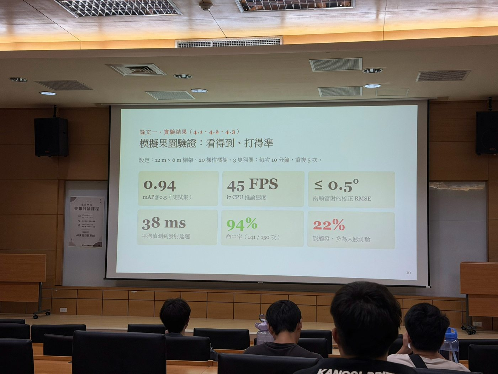
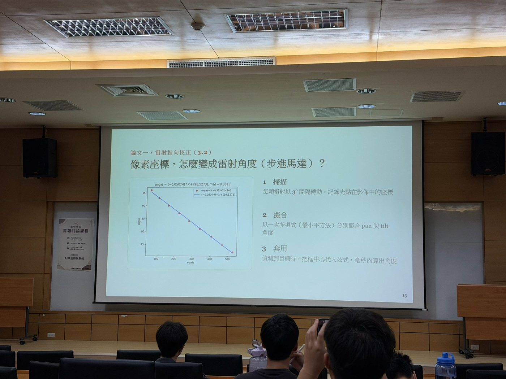

# 專題演講心得報告：AI 果園防猴系統

> 從即時影像辨識、雷射定位到智慧農業的系統整合

_20261013 大同大學資訊工程學系 卓世明老師_

## 簡介

這次演講介紹如何運用人工智慧、影像辨識及自動控制技術，改善臺灣果園遭受獼猴入侵與農作物破壞的問題。傳統防猴方式包含圍網、人工巡視及固定聲音驅趕，但可能面臨維護成本、人力負擔以及獼猴逐漸習慣刺激等限制。因此，研究團隊希望建立一套能夠自動發現目標、判斷位置並進行反應的智慧防護系統。

演講以兩篇研究論文為主軸，說明系統如何從室內概念驗證走向真實果園。第一階段結合 IP 攝影機、YOLOv5 物件偵測、MQTT 通訊、馬達與雷射控制，以及網頁管理介面；後續則進一步研究多目標追蹤、強化學習與抗習慣化的問題。這次報告主要聚焦於第一階段的系統建置，同時簡要討論後續改良方向。

## 相關技術說明

### YOLO 影像辨識

YOLO（You Only Look Once）是一種即時物件偵測技術，能從影像中預測物件類別、信心分數及位置框。研究初期採用 YOLOv5n，並透過約 6,000 張模擬猴子影像建立訓練資料，加入不同角度、光線及背景，讓模型在可控制的環境中先完成驗證。簡報所示的模擬測試 mAP@0.5 約為 **0.94**，但這不代表模型在真實果園也能維持相同準確度，因為現場還有遮蔽、逆光與快速移動等挑戰。

### 模組化系統與 MQTT 通訊

研究將架構分成感測、前處理、智慧決策、執行及人機介面等模組。攝影機提供即時影像，後端負責辨識猴子與計算位置，再經由 MQTT 將控制指令送到執行端。MQTT 是輕量的發布／訂閱式通訊協定，適用於物聯網設備，讓影像辨識端和硬體控制端可以分開設計與維護。

_圖一：系統分層架構，說明從影像擷取到網頁管理的功能分工。_

### 影像座標與馬達校正

偵測到猴子之後，系統需將影像框中心的像素座標換算成伺服或步進馬達的水平、垂直角度。研究透過多個校正點擬合座標與角度的關係，使鏡頭所看到的位置可以轉成硬體動作。簡報顯示角度校正誤差可控制在約 **0.5°** 以內。這項步驟說明，即使辨識模型本身很準確，若沒有做好攝影機與執行裝置的空間校正，整體系統仍可能失敗。

### 網頁管理與事件紀錄

系統使用 Flask 與 Vue 建立 Web 人機介面，呈現即時影像、辨識結果、歷史事件、錄影回放與設備校正功能。這讓管理者不必直接操作每個硬體模組，也能了解設備的工作狀態，並在出現異常時查詢紀錄。

_圖二：網頁提供即時影像、辨識結果、歷史紀錄與控制設定等功能。_

### 實驗結果與限制

簡報中的模擬實驗顯示，模型推論速度約 **45 FPS**，從偵測到發出控制指令的平均延遲約 **38 毫秒**，且在 150 次目標測試中成功命中 141 次，命中率為 **94%**。這些數據表示系統初步具備整合運作的可行性，但它們分別代表模型、控制鏈與命中測試，不能全部視為同一種速度或準確率。

_圖三：概念驗證的主要測試指標。_

研究仍面臨人臉誤辨為猴子、樹葉遮蔽、夜間光線不足與同時出現多隻猴子的挑戰。後續研究因此加入更進階的目標追蹤與決策方法，例如 BoT-SORT 用於維持目標身分，以及 DDPG 強化學習用於改變驅離策略，避免長期固定反應被獼猴習慣。另須注意，任何雷射相關設備都必須進行安全風險評估，避免照射人眼、動物眼睛或其他非預期區域。

## 心得報告

聽完這次演講，我最大的收穫是了解到，完成一套真正能運作的 AI 系統，並不是只要訓練出準確率高的模型就夠了。過去接觸影像辨識時，我比較容易注意到模型的 mAP 或 FPS；但在這套系統中，攝影機取得影像、資料傳輸、座標校正、馬達控制及網頁呈現，任何一個環節出現問題，都可能影響最終效果。

其中我印象最深的是將像素位置轉換成硬體控制角度的部分。對電腦而言，辨識框只是一組數字，但要讓真實裝置對準目標，就需要額外的校正和誤差評估。這讓我體會到，軟硬體整合中的小細節往往比單一功能是否成功更重要。

另外，研究一開始沒有直接到果園進行所有測試，而是先使用玩偶和模擬環境建立資料集。我認為這是值得學習的研究方法，因為在經費、場地與資料不足時，先用可重複、可控制的方式驗證概念，可以比較清楚地找出系統缺陷。不過，這也提醒我不能只因為模擬測試的數據漂亮，就認定系統已經能在實際現場長期穩定運作。

我也注意到誤判是一項重要問題。當 AI 只是顯示辨識框時，誤判看起來可能只是畫面上的錯誤；但如果辨識結果會觸發真實硬體，誤判就可能帶來額外的安全風險。因此，我認為未來的智慧系統應同時記錄偵測準確度、反應時間、誤報與漏報率，並建立適當的安全限制與人工接管機制。

這次演講也讓我想到自己接觸的 UWB 定位與影像監控系統。兩者雖然應用不同，但都需要將感測資料轉換成可供使用者理解的資訊，也會面臨通訊延遲、資料遺失及事件紀錄等問題。如果能參考本研究的模組化架構，把資料接收、狀態判斷、資料庫存取與網頁介面明確分開，應該會更容易測試和排除錯誤。

整體而言，我認為這場演講最有價值的地方，是展示研究如何從生活中的真實需求出發，先建立概念驗證，再根據實驗結果提出下一階段的改良。未來在製作專題或撰寫報告時，我希望能更重視可量測的指標、實驗條件的一致性，以及系統失敗時的原因分析，而不只是展示功能成功的畫面。

## 關鍵字

人工智慧（AI）、智慧農業、YOLOv5、物件偵測、MQTT、影像座標校正、雷射驅離、Web HMI、軟硬體整合。

## 參考文獻

1. Wang, S.-W., Cho, S.-M., Chiu, M.-C., & Chen, S.-C. (2026). _AI-Powered Real-Time Image Recognition System with a Laser-Based Deterrent for Primate Pest Control in Orchards_. Engineering Proceedings, 134(1), 65. https://doi.org/10.3390/engproc2026134065
2. 卓世明（2026 年 10 月 13 日）。_AI 果園防猴系統：從兩篇論文看碩士研究怎麼做_［專題演講簡報］。
3. Ultralytics. _YOLOv5 Documentation_. https://docs.ultralytics.com/yolov5/
4. OASIS. _MQTT Version 5.0_. https://docs.oasis-open.org/mqtt/mqtt/v5.0/mqtt-v5.0.html

---

> 圖片來源：2026 年 10 月 13 日專題演講現場拍攝之簡報照片，僅作課堂心得整理與學習紀錄。若公開使用，請確認講者及簡報素材的授權狀態。
