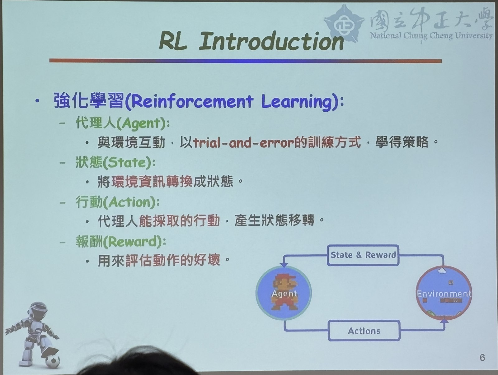
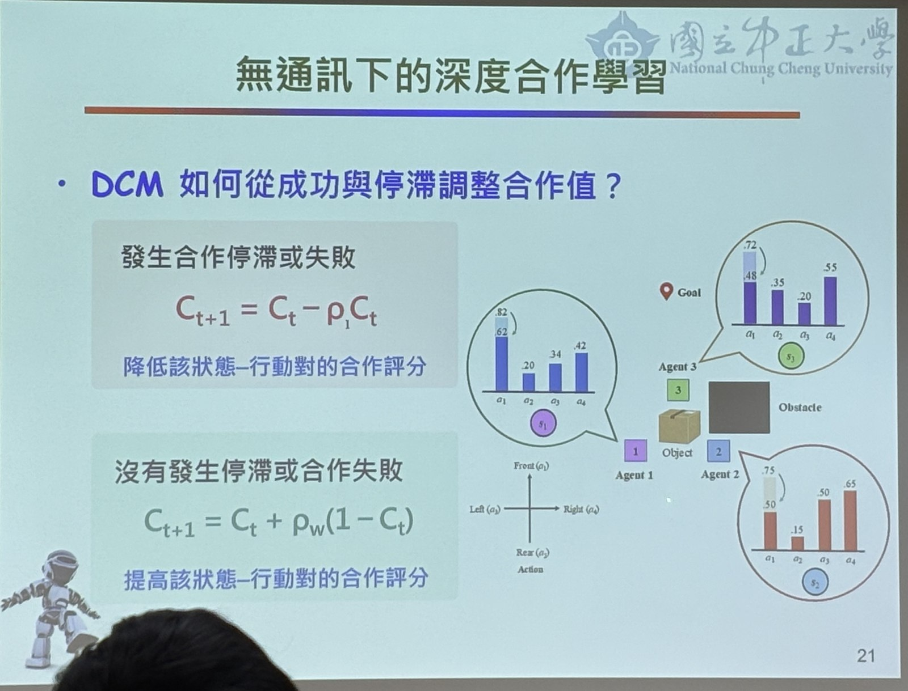
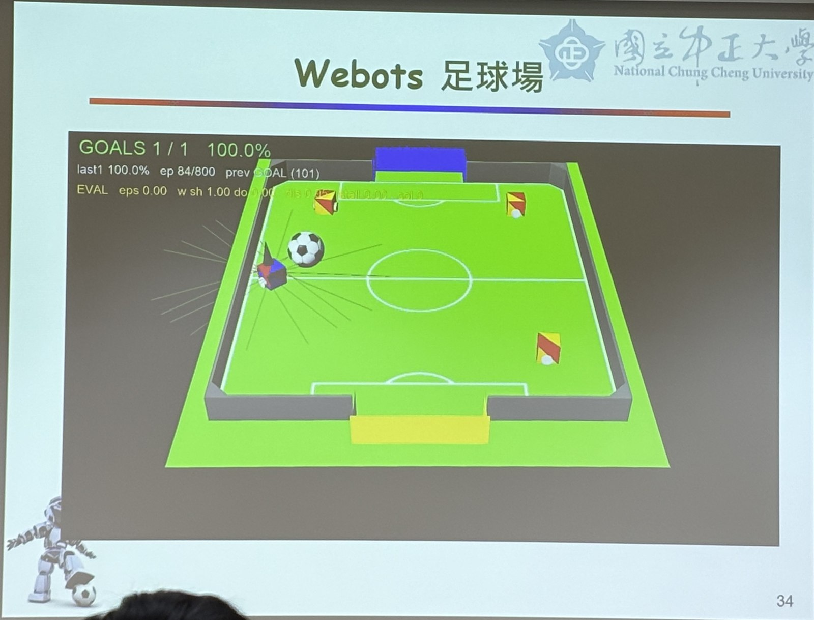

# 深度強化學習於多機器人系統學習與控制

*日期：2026/10/20*  
*講者：蔣惟丞（國立中正大學電機工程學系）*  
*題目：深度強化學習於多機器人系統學習與控制*

## 開頭

這次課程主要介紹如何透過深度強化學習，讓機器人從與環境的互動中學會做決策，以及多台機器人在沒有直接通訊的情況下，如何分工與合作。講者以機器人執行任務為例，從基本的強化學習原理開始，逐步介紹多機器人系統的研究方法與實際模擬成果。

## 介紹強化學習

講者首先介紹強化學習（Reinforcement Learning, RL），其概念是讓機器人透過不斷嘗試與錯誤，找到能獲得較好結果的行動策略。強化學習主要包含四個部分：代理人（Agent）、狀態（State）、行動（Action）以及獎勵（Reward）。代理人會根據目前的環境狀態選擇動作，再依照結果獲得獎勵或懲罰，慢慢學會比較好的決策方式。

課堂中也利用走迷宮的例子說明 Q-Learning，像是抵達終點可以得到獎勵，碰到障礙則會受到懲罰。當環境變得複雜、狀態數量增加時，可以使用深度 Q 網路（Deep Q-Network, DQN），利用神經網路估計不同動作的價值，讓機器人能夠處理更複雜的任務。

## 介紹多機器人合作

接著講者介紹多機器人系統，不同機器人之間可能有完全合作、完全競爭，以及合作與競爭並存等互動關係。相較於只有一台機器人的情況，多機器人必須考慮彼此的行動會如何影響環境，因此學習過程也更加困難。

我印象比較深刻的是，機器人不能只考慮自己眼前能得到多少獎勵，還需要思考自己的行動是否有助於團隊，以及在資訊有限的情況下如何做決策。例如多台機器人一起完成搬運、導航或追捕任務，如果每台都只選擇對自己最有利的動作，不一定能得到最好的整體結果。

## 無通訊下的深度合作學習

本次課程的研究重點是**在沒有直接通訊的情況下，仍讓多台機器人學會合作**。講者介紹利用深度 Q 網路（DQN）負責動作決策，並透過深度合作模型（Deep Cooperation Model, DCM）評估不同動作的合作價值，最後由價值融合模組（ADF）整合資訊，選出適當行動。

其中，合作評分會隨著執行結果調整：當合作發生停滯或失敗時，降低該狀態及動作的合作評分；如果合作順利，則提高評分。這讓機器人即使無法直接互相傳送訊息，也能透過觀察任務結果，逐漸學到適合團隊的行為。

## 研究方法與模擬實驗

講者展示了不同的模擬環境，包含捕食者與獵物、合作搬運，以及多機器人迷宮等情境。透過這些實驗，可以觀察機器人面對移動目標、障礙物或共同任務時，是否能調整策略並完成合作。

後半段也介紹**階層式合作與行為融合**：先讓不同子模型學習導航、射門或找球等能力，再透過融合網路依照當下狀態調整各種行為的權重。講者以 Webots 足球場以及《星海爭霸》的多單位對戰場景做示範，說明深度強化學習不只適用於單一動作，也能延伸到比較複雜的團隊決策。

## 結尾

這次課程讓我更了解強化學習與深度強化學習的差別，也知道多機器人系統的困難不只是讓每台機器人學會動作，而是要讓它們在資訊不完整的情況下互相配合。我覺得無通訊合作的概念很有趣，因為實際環境不一定能保持穩定的網路連線，若機器人仍能靠觀察與學習完成任務，未來在自主移動機器人、智慧工廠或救援等應用上，都有發展的可能。
